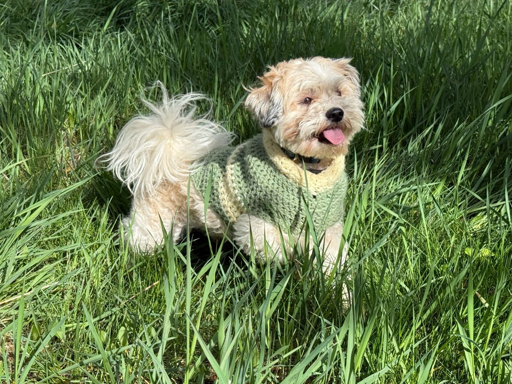

# Jophin Joseph

I’m a bioengineer excited about creating workflows and pipelines to solve hard problems in biology and the life sciences. I have a PhD from the University of Michigan. My research focused on how membrane-bending proteins support endocytosis, including during viral entry. I work at the intersection of wet-lab experiments and software development, building analysis pipelines for microscopy, bioprocessing, and computational biology.

- [Thesis: Mechanical Regulation of Clathrin-Mediated Endocytosis by Membrane Bending Protein Epsin](https://deepblue.lib.umich.edu/handle/2027.42/171399)

- [Biomechanical Role of Epsin in Influenza A Virus Entry](https://pubmed.ncbi.nlm.nih.gov/36135878/) · 2022

- [Complimentary action of structured and unstructured domains of epsin supports clathrin-mediated endocytosis at high tension](https://pubmed.ncbi.nlm.nih.gov/33293652/) · 2020

- [Mechanical Regulation of Endocytosis: New Insights and Recent Advances](https://pubmed.ncbi.nlm.nih.gov/32402120/) · 2020

- [Understanding Influenza A Virus Entry Through Lattice Light Sheet Microscopy](https://www.zeiss.com/microscopy/en/resources/insights-hub/life-sciences/influenza-a-virus-entry-lattice-light-sheet-microscopy.html) · ZEISS, 2023

I work in biopharmaceutical development at Zoetis, where I wear two hats. I lead upstream process development for monoclonal antibodies. I also co-lead the computational fluid dynamics (CFD) team, supporting work across pharmaceuticals, biopharmaceuticals, and diagnostics. I use agentic AI tools to accelerate workflow development and help scientists do better science.

I’m interested in workflows that improve as more data and compute become available, rather than depend on an expanding set of domain-specific heuristics. [(Rich Sutton, 2019)](http://www.incompleteideas.net/IncIdeas/BitterLesson.html)

## Projects

**[Mechanome](https://github.com/jjbaloo2023/mechanome)**

A collection of physical models for how cells generate and respond to forces. It connects membrane mechanics and Bayesian inference with models of tissue junctions, cortical tension, adhesion, and force-sensitive channels. The aim is to compare explanations against experiments while keeping assumptions, uncertainty, and sources attached to each result. I started it during Anthropic’s Built with Claude Science hackathon.

**[Viral entry convergence review](https://github.com/jjbaloo2023/viral-entry-convergence-review)**

A literature review and mechanistic dataset comparing how 38 viruses enter cells. It asks which steps they share, with a focus on endosomal entry and acidification. The review separates experimental findings, inferred mechanisms, and predictions about how viruses might bypass entry blockers.

**[Agent Gym](https://github.com/jjbaloo2023/agent-gym)**

A test system for agents that use scientific software. It records agent actions, tool results, failures, and corrections in CAD and CFD workflows. Current experiments test checkpoint restart and recovery from a stalled solver. The next step is to compare results with physical reference data.

## Outside of work

I love spending time with my family in West Michigan. I also love tinkering and learning new things, whether that means figuring out where plants should go in my garden beds or working through plumbing and electrical code requirements during a home renovation.

Meet Baloo, the namesake of my GitHub account.

## Contact

If you’d like to talk about the projects, science, or something you’re building, feel free to reach out.

[Email](mailto:jophingj@gmail.com) · [LinkedIn](https://www.linkedin.com/in/jophingj/) · [Google Scholar](https://scholar.google.com/citations?user=1GXfdBAAAAAJ) · [GitHub](https://github.com/jjbaloo2023) · [Resume](https://jjbaloo2023.github.io/assets/jophin-joseph-resume.pdf)

[Portfolio](https://jjbaloo2023.github.io/)
